# Detection of Government-Issued PII Embedded in Documents and Data

> **GovPII Sentinel**: An AI-assisted Cybersecurity PII Detection, Data Protection, and Risk Classification Platform.

[](https://nodejs.org/)
[](https://reactjs.org/)
[](https://tailwindcss.com/)
[](https://ai.google.dev/)
[](https://firebase.google.com/)

---

## Overview

Organizations handle millions of unstructured documents, forms, scanned records, and emails daily. Many inadvertently contain high-risk, government-issued Personally Identifiable Information (PII). 

**GovPII Sentinel** enables security analysts and compliance officers to upload documents (PDF, DOCX, TXT) or paste raw text to:
1. **Identify** potential government identifiers using deterministic regex patterns, algorithmic check digits, and contextual keywords.
2. **Semantically Validate** findings via Google Gemini 3.8 Flash to disambiguate edge cases and prevent false positives.
3. **Cryptographically Mask** sensitive entities (`XXXX-XXXX-1234`, `AXXXXXX4F`) before visualization or persistence.
4. **Calculate Risk Levels** (`LOW`, `MEDIUM`, `HIGH`) and generate formal compliance remediation roadmaps.
5. **Export Audit Reports** in print-ready or downloadable PDF formats aligned with the Digital Personal Data Protection (DPDP) Act and ISO/IEC 27701.

---

## Architecture

```
PII-Detection/
│
├── frontend/                     # React 18 + Vite + Tailwind CSS + Lucide
│   ├── src/
│   │   ├── components/           # RiskBadge, MaskedSnippet, Dropzone, SyntheticTemplates, PiiTable, StatsCards, Sidebar, Navbar
│   │   ├── pages/                # Dashboard, DocumentScanner, TextScanner, DetectionResults, ScanHistory, SecurityReport, Settings, Login, Register
│   │   ├── services/             # api.js, auth.js, firebase.js, reportGenerator.js
│   │   ├── App.jsx               # React Router & Protected Layout
│   │   ├── main.jsx              # DOM Root
│   │   └── index.css             # Cybersecurity Styling
│   ├── package.json
│   └── vite.config.js
│
├── backend/                      # Node.js + Express
│   ├── routes/                   # scanRoutes, historyRoutes, dashboardRoutes, settingsRoutes
│   ├── controllers/              # scanController, historyController, dashboardController, settingsController
│   ├── services/                 # textExtractor (PDF/DOCX/TXT), fileService, syntheticSamples
│   │   └── piiDetector/          # Modular Multi-Tier Engine
│   │       ├── patterns.js       # Regex & Verhoeff Checksum Algorithm
│   │       ├── contextAnalyzer.js# NLP Keyword Proximity & False Positive Filters
│   │       ├── geminiAnalyzer.js # Gemini 3.8 Flash Privacy-Preserving Semantic Analysis
│   │       ├── masker.js         # Tailored Masking & Snippet Redaction
│   │       ├── riskClassifier.js # Risk Scoring (0-100) & Remediation Advice
│   │       └── index.js          # Unified Pipeline Coordinator
│   ├── uploads/                  # Ephemeral Processing Cache (Auto-Purged)
│   ├── database/                 # Firebase Admin Firestore + Zero-Config Local Persistent Fallback
│   ├── middleware/               # auth.js, upload.js, errorHandler.js
│   ├── server.js                 # Express Application Bootstrap
│   ├── package.json
│   └── .env.example
│
└── implementation_plan.md
```

---

## Detection Pipeline & Privacy Guarantees

```mermaid
flowchart LR
    A[Input: PDF / DOCX / TXT / Text] --> B[Text Extraction]
    B --> C[Tier 1: Patterns & Verhoeff Checksum]
    C --> D[Tier 2: NLP Context Anchors]
    D --> E[Tier 3: Gemini 3.8 Flash Verification]
    E --> F[Deduplication & Confidence]
    F --> G[Tier 4: Risk Classification]
    G --> H[Tier 5: Data Masking]
    H --> I[Audit Registry & PDF Report]
```



### Privacy & Data Protection Safeguards:
- **Zero Complete Raw PII Exposure**: Complete sensitive values are masked (`XXXX-XXXX-1234`) directly in the detection service.
- **Privacy-Preserving AI**: Only anonymized contextual excerpts with redacted candidate tokens are transmitted to Gemini API.
- **Immediate Disk Shredding**: Uploaded files in `backend/uploads/` are unlinked and destroyed immediately following in-memory extraction.
- **Zero Raw PII Storage**: Firestore and database registries store only metadata, detection counts, category tags, and masked snippets.
- **Synthetic Test Data Included**: The platform comes pre-configured with 100% synthetic test documents and presets.

---

## Supported Government & Sensitive Identifiers

| Category | Typical Format / Pattern | Validation Method | Risk Weight |
|---|---|---|---|
| **Aadhaar-like** | 12 digits (4-4-4 format) | Regex + Verhoeff Checksum algorithm + UIDAI context | HIGH |
| **PAN-like** | 5 letters + 4 digits + 1 letter | Structural syntax + 4th character status code + IT context | HIGH |
| **Passport-like** | 1 letter + 7 digits | Indian passport standard format + nationality context | HIGH |
| **Driving Licence-like** | State code + RTO + Year + Digits | Structural syntax + Transport Authority context | HIGH |
| **Voter ID (EPIC)-like** | 3 letters + 7 digits | Election Commission format + electoral context | HIGH |
| **Gov / Beneficiary ID** | UAN (12 digits) / ABHA (14 digits) / PPO | Structural pattern + Social security / Health mission context | HIGH |
| **Phone Numbers** | +91 / 0 followed by 10 digits | Mobile numbering plan regex + telecommunication context | MEDIUM |
| **Email Addresses** | RFC-compliant standard emails | Syntax regex + communication context | LOW |

---

## Setup & Getting Started

### Prerequisites
- **Node.js**: v20+ or v24+ LTS installed
- **npm**: v10+ or v11+ installed

### 1. Installation

#### Backend
```bash
cd backend
npm install
```

#### Frontend
```bash
cd ../frontend
npm install
```

---

## Configuration

### 1. Backend Configuration (`backend/.env`)

Copy `backend/.env.example` to `backend/.env`:
```env
PORT=5000
NODE_ENV=development
CLIENT_URL=http://localhost:5173

# Google Gemini API Key (Optional but recommended for Tier-3 AI Verification)
# Get a free key at: https://aistudio.google.com/
GEMINI_API_KEY=your_gemini_api_key_here

# Firebase Admin Credentials (Optional: Falls back to Persistent Local Storage automatically if omitted)
FIREBASE_SERVICE_ACCOUNT_KEY=
# Or:
FIREBASE_PROJECT_ID=
FIREBASE_CLIENT_EMAIL=
FIREBASE_PRIVATE_KEY=
```

### 2. Frontend Configuration (`frontend/.env`)
Optional: If connecting to your own Firebase project:
```env
VITE_FIREBASE_API_KEY=your_api_key
VITE_FIREBASE_AUTH_DOMAIN=your_project.firebaseapp.com
VITE_FIREBASE_PROJECT_ID=your_project_id
VITE_FIREBASE_STORAGE_BUCKET=your_project.appspot.com
VITE_FIREBASE_MESSAGING_SENDER_ID=your_sender_id
VITE_FIREBASE_APP_ID=your_app_id
```
*(Note: A built-in Instant Demo Analyst Mode is included by default, allowing complete platform evaluation without requiring external credentials).*

---

## Running the Application

### Option A: Running Backend and Frontend

1. **Start the Backend Server (Port 5000)**:
   ```bash
   cd backend
   npm start
   # or for auto-reloading:
   npm run dev
   ```

2. **Start the Frontend Development Server (Port 5173)**:
   ```bash
   cd frontend
   npm run dev
   ```

3. Open your browser and navigate to:
   ```
   http://localhost:5173
   ```

---

## Building for Production

### Frontend Production Build
```bash
cd frontend
npm run build
```
The optimized production bundle will be generated in `frontend/dist/`.

---

## API Endpoints Reference

| Method | Endpoint | Description | Auth Required |
|---|---|---|---|
| `GET` | `/api/health` | System health and AI engine status | No |
| `POST` | `/api/scan/text` | Scan pasted text for government PII | Yes (or Demo Session) |
| `POST` | `/api/scan/document` | Upload and scan PDF/DOCX/TXT file | Yes (or Demo Session) |
| `GET` | `/api/scans` | Retrieve scan metadata history | Yes |
| `GET` | `/api/scans/:id` | Get single scan audit report by ID | Yes |
| `DELETE` | `/api/scans/:id` | Delete scan record from registry | Yes |
| `GET` | `/api/dashboard/stats` | Aggregated telemetry & risk stats | Yes |
| `GET` | `/api/settings` | Retrieve active inspection rules | Yes |
| `PUT` | `/api/settings` | Update inspection thresholds | Yes |

---

## Compliance & Legal Disclaimer

Detections made by this system are classified as **Potential PII**. The platform is designed as an automated auditing and privacy-safeguarding tool to assist compliance teams. Algorithmic findings do not constitute legal validation of government credentials.
